# Summon icons

Concept: a cluster of three four-point sparkles, meaning "press a key and the app appears."

| File | Use |
|---|---|
| `app-icon-light.svg` | App icon, light appearance: violet→magenta sparkles on a lavender background |
| `app-icon-dark.svg` | App icon, dark appearance: pale glowing sparkles on deep indigo |
| `menubar-template.svg` | Menu bar status item (18×18 pt), pure black on transparent |
| `preview.html` | Shows every icon at 256–16 px, with mock light and dark menu bars |

To view the preview, serve this folder (e.g. `python3 -m http.server`) and open `preview.html`.

## Menu bar icon

- Ship **one** asset and mark it as a template image. macOS colors it black or white for light and dark menu bars and handles the highlighted state.
  - In code: `image.isTemplate = true`
  - In an asset catalog: set *Render As* to **Template Image**, and enable *Preserve Vector Data* if you import the SVG/PDF.
- Keep it pure black + alpha. Any color is ignored once it's a template image.
- Size: 18×18 pt canvas (16–18 pt glyph is typical for status items).

## App icon

Step-by-step: [ICON-COMPOSER.md](ICON-COMPOSER.md), with layer files in [`layers/`](layers/).

- Use **Icon Composer** (ships with Xcode 26). It builds a single `.icon` file with light, dark and tinted/clear variants, and macOS picks one based on the user's appearance setting.
- Import the elements as separate layers (background, large sparkle, small sparkles) so they get the Liquid Glass depth and specular effects. The SVGs are already structured that way.
- The background squircle in the SVGs follows the macOS icon grid (an 824 px rounded rect inside a 1024 canvas). Icon Composer supplies its own mask, so you may only need the sparkle layers plus a background fill.

## About window / product page

- Pick light or dark based on the current appearance:
  - AppKit: check `NSApp.effectiveAppearance.bestMatch(from: [.aqua, .darkAqua])`, or just use `NSApp.applicationIconImage`, which already follows the system appearance when the `.icon` file is set up.
  - Web:
    ```html
    <picture>
      <source srcset="app-icon-dark.svg" media="(prefers-color-scheme: dark)">
      
    </picture>
    ```
- The App Store needs a 1024×1024 PNG export. Export from the SVGs or from Icon Composer.

## Design notes

- Palette, light: background `#F7F5FF`→`#D9D1FB`; sparkle `#8B5CF6`→`#D946EF`; accents `#C084FC`, `#A78BFA`.
- Palette, dark: background `#25213A`→`#0E0C18`; sparkle `#C4B5FD`→`#F0ABFC`; accents `#E9D5FF`, `#C4B5FD`; violet halo behind the large sparkle.
- Caveat: the four-point sparkle is widely used for AI features (Gemini, Apple Intelligence, "✨ AI" buttons), so people may read it as "AI". Ways to make it less generic: a different number of points, a short motion trail, or a warmer color.
